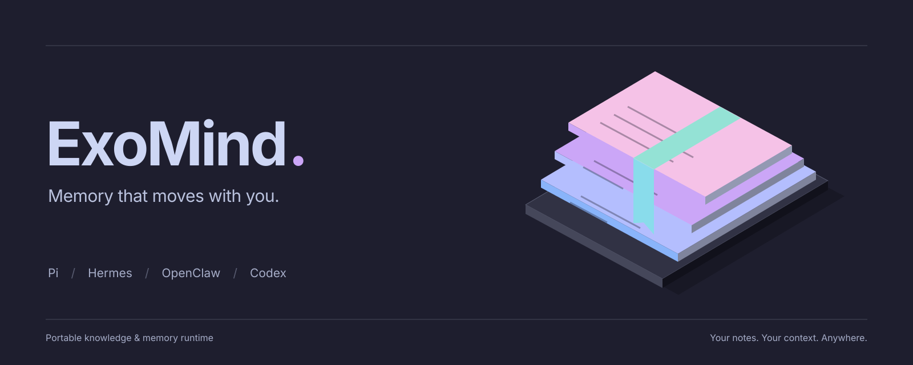

# ExoMind




Portable knowledge-method runtime that keeps OpenClaw/Codex agents tightly aligned with your own trusted data. ExoMind orchestrates local knowledge indexing, recall, and runtime health checks so that workflows can consume agent-ready context without leaking private notes.

## Why ExoMind?

- **Reliable context for agents** – build a term-graph of your knowledge store and let `exom recall` surface the right breadcrumbs for each session.
- **Operational peace of mind** – `exom doctor` and `exom index` ensure your runtime caches stay healthy and reproducible.
- **Integration-first** – designed to slot under OpenClaw and Codex orchestration layers with minimal fuss.

## Quickstart

### 1. Install the runtime (Rust-first)

Rust toolchains can install the CLI with:

```bash
cargo install --path .
```

Never built locally? run `cargo run --bin exom -- <command>` from the repo root instead.

### 2. Initialize your layout

If you want the opinionated workspace layout, bootstrap it once:

```bash
exom init --path .
```

or, while developing, use `cargo run --bin exom -- init --path .`.

### 3. Build a knowledge graph

Run `exom index` against your trusted knowledge root and point the output at `.neural`:

```bash
exom index --notes-root <YOUR_KNOWLEDGE_PATH> --out-root .neural
```

### 4. Recall context during agent sessions

Provide `exom recall` with your qualitative query, the graph, and a `topk` cutoff that matches your workflow:

```bash
exom recall --query "mamba eeg" --topk 10 --graph .neural/graph.json
```

### 5. Keep the runtime healthy

```bash
exom doctor --notes-root <YOUR_KNOWLEDGE_PATH> --graph .neural/graph.json
```

This command validates caches and surfaces missing pieces before each agent session.

### 6. Autocapture with typed relations

Capture quick observations from the CLI and let ExoMind append them to the inbox layout. By default a note lands at `00_Inbox/YYYY-MM-DD-auto.md`, and any `REL:TYPE(from->to)[confidence]` slices you provide are serialized into a fenced YAML block for downstream tooling.

```bash
exom capture --input "REL:CAUSED_BY(Demo->Spec)[0.75] outcome posted" --notes-root .
exom capture --file ./assets/synthetic/snippet.txt --out-note 00_Inbox/ci-capture.md --notes-root .
```

Swap `--input` for `--file`, override `--out-note` for a specific target, and append `--json` whenever you need machine-readable traces.

### 7. Memory lifecycle housekeeping

Tame stale inbox notes with `exom lifecycle`. The default `consolidate` mode rewrites `99_Archives/consolidated-YYYY-MM.md` with summaries of inbox files older than a few days, `--mode decay` appends deterministic `<!-- lifecycle last_reviewed=… decay_score=… -->` markers, and `--mode archive --older-than-days 30` moves long-lived notes into `99_Archives/Inbox`.

```bash
exom lifecycle --mode consolidate --notes-root . --json
exom lifecycle --mode archive --older-than-days 60 --notes-root .
```

`--notes-root` and `--json` behave consistently across capture, recall, doctor, benchmark, and lifecycle invocations.

## Hybrid recall & benchmark sample

`exom recall` blends title/path overlap, BM25 length-normalized content relevance, and graph influence. Graph influence only boosts candidates that match the query. Vietnamese diacritics are folded consistently at indexing and query time; re-run `exom index` after upgrading to enable matching against previously accented content. Existing TF-IDF cache files remain readable; BM25 reconstructs term counts from their stored weights. The legacy `--semantic-weight` flag now controls BM25, not dense embeddings. `pi-context` selects an excerpt starting at the best matching content line rather than always returning the beginning of a note.

See [the Zero-Mem-inspired experiment](docs/zero-mem-inspired.md) for the prototype and [real-vault evaluation](docs/recall-evaluation.md) for measurements and limitations. The sample dataset at `30_Resources/Schemas/benchmark-sample.json` is intentionally synthetic, showcasing how the hybrid recall signal balances lexical and relational context without any personal data.

Use the sample graph to verify hybrid recall behavior or to exercise the benchmark pipeline:

```bash
cargo run --bin exom -- recall --query "hybrid recall sample" --topk 3 --graph 30_Resources/Schemas/benchmark-sample.json
cargo run --bin exom -- doctor --notes-root 30_Resources --graph 30_Resources/Schemas/benchmark-sample.json
```

The dataset contains fictional nodes such as the "Hybrid Recall Concepts" note and a "Benchmark Execution Playbook," so the smoke runs remain safe for public CI while mirroring the real graph structure.

## Research evaluation standard

Future memory/retrieval optimization follows [benchmark protocol v1](docs/benchmark-protocol.md): LongMemEval cleaned-S as the primary public memory evaluation, LoCoMo as secondary, and frozen real-vault held-out validation. Primary optimization measures evidence coverage under a fixed reader-token budget, not note Hit@1 alone. The protocol specifies ablations, paired uncertainty, abstention/update checks and quality-cost gates; current scripts do not yet implement the full suite.

## Optional BGE-M3 hybrid retrieval

For local semantic/multilingual retrieval alongside BM25, see [hybrid recall setup and deep real-vault results](docs/hybrid-recall.md). This opt-in Python entry point keeps the Rust default lightweight; model downloads and RAM are required. It includes explicit index/recall/context commands and a private-data benchmark runner. Existing Pi/MCP hooks are not changed automatically.

## Agent integrations (Pi, Hermes, any MCP client)

ExoMind ships one MCP server (`exom mcp`) and one skill (`skills/exomind/SKILL.md`) that work for both Pi and Hermes Agent — no per-agent code paths. Wire everything up in one command:

```bash
scripts/install-agent.sh --agent all --notes-root ~/Yasna-Memory
```

`--agent pi` writes the `exomind` entry into `~/.pi/agent/mcp.json` and installs the skill to `~/.pi/agent/skills/exomind/`; `--agent hermes` runs `hermes mcp add exomind ...` and installs the skill to `~/.hermes/skills/exomind/`. Existing skills are left untouched unless you pass `--force`.

Either agent then gets `exom_recall`, `exom_capture`, `exom_index`, and `exom_doctor` as tools. Non-MCP clients can shell out instead: `exom recall`, `exom capture`, and `exom pi-context` (plain markdown block for prompt injection, despite the Pi-flavoured name).

Verify the connection with `hermes mcp test exomind` (Hermes) or `exom doctor` (both).

## Integration with OpenClaw & Codex

1. Keep the real knowledge in your own protected path (`--notes-root`).
2. Run `exom index` on schedule (cron or CI) so the cached graph stays in sync.
3. Feed `exom recall` output to Codex prompts or OpenClaw contexts; update `/root/.openclaw/workspace/skills/exomind-openclaw/scripts/exom.sh` to invoke `cargo run --bin exom`.
4. Use `exom doctor` before deploying new setup changes or when troubleshooting runtime drift.
5. Track infrastructure/configuration files in GitHub so collaborators can reproduce the runtime state.

## Repository layout

- `src/main.rs` – Rust-first CLI that powers `exom init/index/recall/doctor`
- `src/exomind/` – deprecated Python runtime for `serve`/`mcp` or compatibility scripts
- `scripts/` – Bootstrap helpers, agent installers, hybrid retrieval tools, and benchmark runners
- `skills/exomind/` – Agent-neutral skill definition shared by Pi and Hermes
- `.neural/` – generated cache files from `exom index` (gitignored)
- `00_Inbox/`, `10_Projects/`, `20_Areas/`, `30_Resources/`, `99_Archives/` – optional template folders inspired by the PARA method
- `Makefile` – convenience commands and aliases

## Legacy Python runtime (fallback)

The previous Python CLI still lives in `src/exomind/cli.py`. Install it with `pip install exomind`
or `pip install -e .` if you need the legacy `exom serve`/`exom mcp` helpers. Rust remains the preferred
path, and the Python artifacts exist mainly for compatibility.

## Contributing

See [`CONTRIBUTING.md`](CONTRIBUTING.md) for guidelines, issue templates, and testing expectations.

## License

This project is available under the MIT License. See [`LICENSE`](LICENSE) for details.
